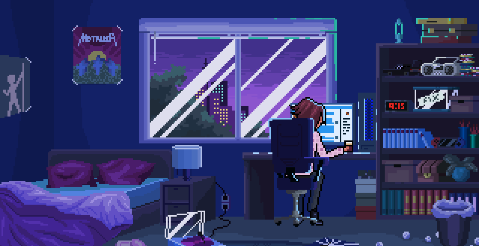
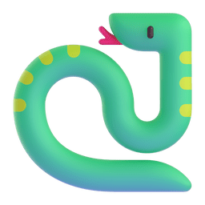

  <h1>Hi 👋, I'm Yash Dayani</h1>
  
<b>Full-stack and macOS developer at <a href="https://techuplabs.com">TechUp Labs</a></b> 
  I build production web platforms in TypeScript and Next.js, and native macOS apps in Swift.

  

 

<h3>About Me</h3>

- 🧑‍💻 I work at **TechUp Labs** on **[Feedspace](https://feedspace.io)** and on client platforms, from the UI down to the APIs and integrations.
- 🍎 In my own time I build **native macOS apps** in SwiftUI. They're fast, local-first, and need no installers or accounts.
- 📈 I've merged **300+ pull requests** in the last two years.
- 📍 India · 🌐 [yashday.vercel.app](https://yashday.vercel.app)

 

<h3>Featured Projects</h3>

| Project | What it is | Stack |
| :-- | :-- | :-- |
| 🎙️ **[Rattle](https://github.com/YashDayani/Rattle)** | Dictation and meeting notes for macOS. Hold a key, speak, and the text lands wherever your cursor is. Transcription runs on-device with whisper.cpp, there's no meeting bot, and it ships with Shortcuts, an MCP server, and signed in-app updates. | Swift · SwiftUI · whisper.cpp |
| 🗜️ **[ArchiveX](https://github.com/YashDayani/ArchiveX)** | A fast, native archive manager for macOS with its **own archive engine**. It opens and creates ZIP, 7z, RAR (3 and later, including a RAR writer), TAR and more, with no third-party code. | Swift · SwiftUI |
| 💬 **[Feedspace](https://feedspace.io)** | A platform for collecting and showcasing testimonials. I work on the Next.js frontend, the embeddable widget, the public API docs, and an MCP server. | Next.js · TypeScript |
| 🏢 **Kalaa System** | An internal operations platform: customers, delivery, finance, and CRM with in-browser calling. It also covers Facebook and Instagram post, Reel, and Story scheduling, and an in-app assistant. I've merged **160+ PRs** here. | TypeScript · Meta Graph API |

 

<h3>Tech I Use</h3>

  
  
  
  
   
  
  
  
  
  
  
  
   
  
  
  
  
  
  

 

<h3>My Contributions</h3>

 

<h3>My Stats</h3>
 

<!--START_SECTION:waka-->
<!--END_SECTION:waka-->

  

 

<h3>Get in Touch</h3>

  &nbsp;
  &nbsp;
  &nbsp;
  &nbsp;
  

